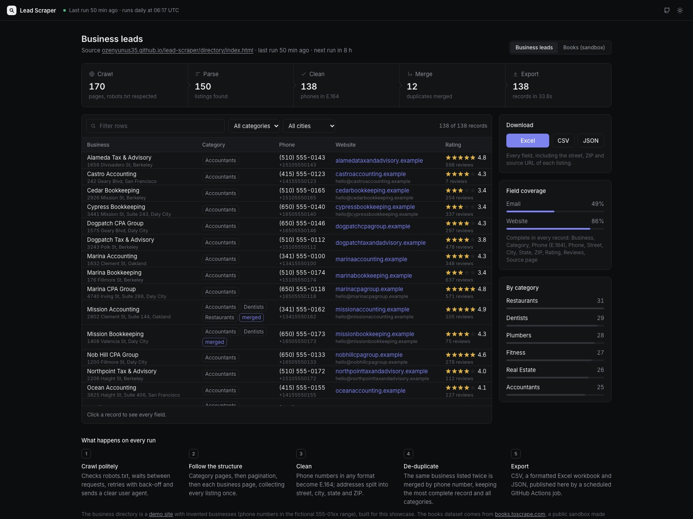
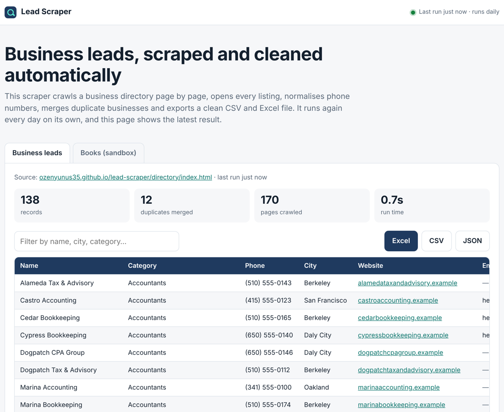
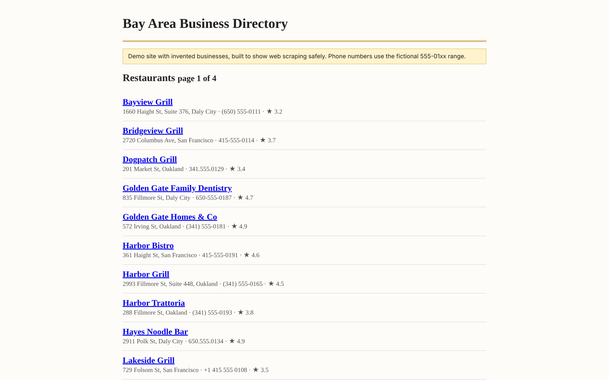

# Lead Scraper

A polite web scraper that turns a business directory into a clean, de-duplicated and enriched lead list: e-mails and social profiles from each business's own website, checked and scored, ready to import into a CRM. It runs again every day and reports what opened, closed or changed.

**Live results:** https://ozenyunus35.github.io/lead-scraper/



## What it does

- **Crawls the whole site structure:** category pages → pagination → every business page.
- **Is polite by default:** reads `robots.txt`, waits between requests, honours `Retry-After`, retries with exponential back-off, never fetches the same page twice, sends a clear user agent.
- **Survives messy sites:** a redesigned or broken page, a dead link, a PDF where a page should be, a pagination loop or a page with no charset is skipped or read correctly and counted, never a crash. If a site returns nothing at all, nothing is written, so the last good results stay published.
- **Cleans the data:** phone numbers written in any format (`(415) 555-0134`, `415.555.0134`, `+1 415 555 0134`) become one standard (E.164); addresses are split into street, city, state and ZIP.
- **Merges duplicates:** the same business listed twice is merged when the phone number and the name match (`Harbor Grill LLC` = `The Harbor Grill`), or, for a copy with no phone, the name and ZIP. Two different businesses behind one switchboard number stay separate. The most complete record is kept and all of its categories are combined.
- **Finds contacts on each business's website:** home, contact and team pages (following links the way a person would), for e-mail addresses, LinkedIn, Facebook, Instagram and X, plus extra phone numbers. Addresses written as `info [at] shop [dot] com` are decoded; look-alikes such as `logo@2x.png`, a template's `you@example.com`, a form placeholder or a tracker's address are skipped. Dead and parked sites are reported as such.
- **Checks every e-mail** without sending anything: a named person at the business's domain, a shared inbox (`info@`), free mail, a disposable inbox or invalid. The best address comes first: the business's own domain, a person before a shared inbox.
- **Scores each lead 0-100:** ways to reach it, quality of the contact, reputation (rating and reviews) and completeness, so a sales team starts at the top.
- **Tracks changes day to day:** compares with the previous run and marks businesses that are new, changed (phone, address, e-mail, rating, with the before and after) or no longer listed.
- **Exports** CSV (UTF-8, opens correctly in Excel), a formatted Excel workbook (frozen header, filters, clickable links), JSON, and a CRM import file in HubSpot's company columns (Salesforce and Pipedrive map them too). The results page exports whatever you filtered (named-person e-mails only, score 70+, new today) the same way.
- **Runs on a schedule:** a GitHub Actions job scrapes every morning and publishes the fresh results to the page above.
- **Shows its work:** the results page lists what the last run did (pages crawled, listings parsed, phones
  normalised, duplicates merged), how complete each field is, and the full record behind every row.

| Results page | Demo directory being scraped |
| --- | --- |
|  |  |

## Data sources

- **Business leads:** a [demo directory](https://ozenyunus35.github.io/lead-scraper/directory/index.html) with invented businesses and their own small websites, generated by `demo_directory/generate.py`. Phone numbers use the fictional 555-01xx range and domains the reserved `.example`. It is deliberately messy, like real directories: mixed phone formats, missing fields, repeated listings, and websites that hide their address, show only a contact form, are parked or gone. Every day one business closes, one opens and one changes, so the daily run has something to report.
- **Books:** [books.toscrape.com](https://books.toscrape.com/), a public sandbox made for scraping practice, to show the same tool on an external site.

## Run it

```bash
pip install -r requirements.txt

# books.toscrape.com, first 5 pages, 1 request per second
python -m scraper books --max-pages 5 --delay 1 --out data

# the demo directory (published copy), with contacts from each website;
# --previous compares with an earlier run's JSON, --no-enrich skips the website visits
python -m scraper directory --out data --previous data/directory.json

python -m playwright install chromium webkit  # once, for the browser tests
python -m pytest -q  # scraper tests + results page on desktop Chrome, Safari, iPhone and Android
```

Each run writes `data/<site>.csv`, `data/<site>.xlsx` and `data/<site>.json` (plus `data/directory-crm.csv`) and prints a short summary.

## Adapting it to a new site

Each site is one small module in `scraper/sites/` with a `scrape(start_url, fetcher)` function and a list of output fields. Crawling, politeness, cleaning, de-duplication and export are shared, so a new source usually means writing the selectors for its list and detail pages.

## Project layout

```
scraper/            the scraper package (CLI: python -m scraper)
  http.py           polite fetcher: robots.txt, delay, retries
  clean.py          phone normalisation and de-duplication
  enrich.py         contact finder: e-mails, social profiles and phones from each website
  quality.py        e-mail checks and the lead score
  changes.py        what opened, closed or changed since the last run
  export.py         CSV, Excel, JSON and CRM import output
  sites/            one module per source
demo_directory/     generator for the demo business directory
site/               results page published to GitHub Pages
tests/              unit tests and a full crawl against a local copy of the directory
```

## Responsible use

Scrape only data you are allowed to collect, respect each site's terms and `robots.txt`, keep request rates low, and handle personal data according to the laws that apply to you (GDPR, CCPA and similar).

---

Built by [Yunus Ozen](https://ozenyunus35.github.io/yunus-ozen-portfolio/). Need leads from a specific directory, marketplace or map listing, delivered once or on a schedule? Get in touch.
